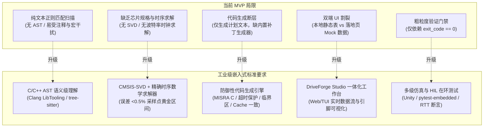
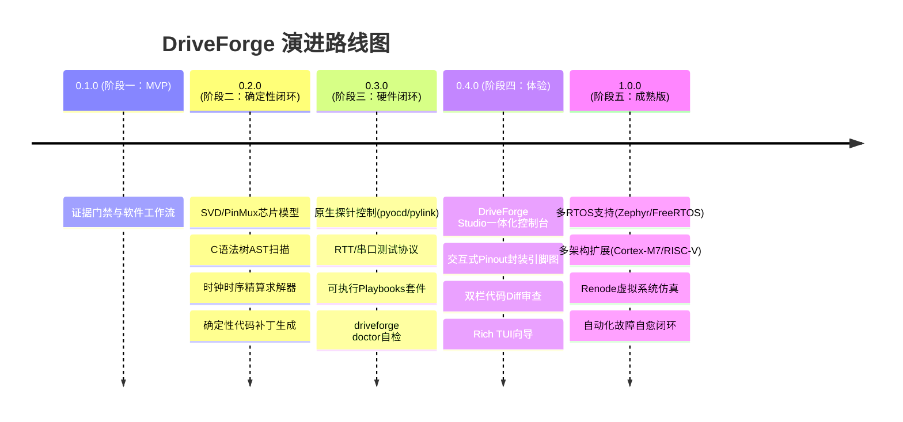

# DriveForge 演进蓝图与现代化驱动工程规范设计指南
> **DriveForge Evolution Blueprint: Modern Embedded Driver Engineering Architecture**  
> 版本：v1.0.0 | 状态：阶段二已完成，后续阶段规划中 | 适用目标：DriveForge 0.2.0 ~ 1.0.0 重构演进

---

## 1. 文档概述与愿景目标

### 1.1 背景与定位
DriveForge 是一个面向嵌入式底层软件的**证据优先（Evidence-first）**自主工程智能体。在 MVP（0.1.0）阶段，项目奠定了三条不可动摇的设计不变量：
1. **硬件事实必须来源可追溯（Evidence-backed Facts）**，杜绝大模型臆测硬件参数；
2. **复用优先、重写垫后（Adapt First, Rewrite Last）**，尽可能继承现有工程与成熟 BSP 资产；
3. **显式阶段门禁（Explicit Verification Gates）**，严格区分构建通过、烧录通过与硬件验证通过。

随着驱动开发向现代工业级高可靠性、跨平台兼容性以及自动化验证演进，DriveForge 需从初期的“脚本级辅助工具”升级为**端到端全自主嵌入式驱动工程平台（Autonomous Embedded Driver Engineering Platform）**。

### 1.2 核心使命
消除嵌入式驱动适配中繁琐、易错且重复的机械性工作（查手册算分频、找引脚核对 AF、补全时钟门控、编写样板初始化、单步调试定位寄存器），在**严格遵循现代嵌入式工业规范（如 MISRA C:2012、CMSIS 规范、RTOS 设备驱动模型）**的前提下，实现：

$$\text{自然语言需求} \longrightarrow \text{确定性事实与时序求解} \longrightarrow \text{高质量防御性代码补丁} \longrightarrow \text{仿真/HIL 自动化闭环验证}$$

---

## 2. 现状诊断与工业级工程差距

### 2.1 现有实现优势（保留并强化）
- **证据链门禁机制**：基于 `Confidence` 等级（VERIFIED, HIGH, MEDIUM, LOW, UNKNOWN）严格阻断无把握的执行。
- **差异复用策略（Adapt-First）**：优先寻找同芯片同外设的其他通道（如已有 CAN1 时优先适配 CAN0），大幅降低引入新 Bug 的概率。
- **源码基线追踪**：通过文件哈希比对，记录从 Plan 到 Run 发生变动的每一行代码。

### 2.2 核心瓶颈与工程差距诊断



| 维度 | 当前 MVP 实现 | 工业级嵌入式驱动规范差距 |
| :--- | :--- | :--- |
| **代码与项目理解** | 正则搜索关键字与宏定义 | 无法感知 `#if / #else` 条件编译分支；统计芯片型号出现频次易受头文件枚举误导；无法解析复杂结构体初始化。 |
| **硬件事实精准度** | 仅依赖规则匹配引脚字符串 | 缺少引脚复用（Alternate Function, AF）合法性校验；缺少引脚物理封装（Package）引出校验；缺少时钟树与分频计算。 |
| **代码生成与质量** | 依赖外部脚本或人工补丁 | 缺乏嵌入式防御性规范：死循环轮询缺少超时退出 Guard；涉及 DMA 时缺少 Cache 一致性维护；缺乏临界区原子保护。 |
| **交互与开发体验** | 纯 CLI 命令行长参数传递 | 事实缺失时直接阻塞，缺乏交互式引导（TUI Wizard）；调试设备与串口需要手动探查并传入。 |
| **界面与展示呈现** | `viewer.py` 与 `website/` 割裂 | 本地 HTML 仅为只读表格；精美的 3D Antigravity 控制台仅使用 Mock 假数据，两者未打通为统一产品。 |
| **测试与验证手段** | 执行脚本判断 `exit_code == 0` | 无法捕获寄存器硬件错误状态、无法统计丢包率、无法进行环回自测断言与外部节点协议互通。 |

---

## 3. 核心维度系统性优化建议

### 3.1 兼容性架构优化（Compatibility）

#### A. 芯片规格与外设建模库（Chip Spec Engine）
1. **CMSIS-SVD 官方规范原生解析**：
   - 内置轻量级 CMSIS-SVD 解析引擎，直接加载芯片厂商提供的标准 `.svd` XML 文件。
   - 精准提取：外设基地址（Base Address）、寄存器偏移与位段（Bitfields）、中断向量（Interrupt IRQn）、总线挂载关系（AHB1/AHB2/APB1/APB2）。
2. **多芯片架构与厂商扩展**：
   - 纵向扩展：从 Cortex-M4 延伸至 **Cortex-M0+、Cortex-M3、Cortex-M7（Cache 特性）、Cortex-M33（TrustZone 特性）**。
   - 横向扩展：支持 **RISC-V 架构**（如沁恒 CH32V 系列、乐鑫 ESP32-C 系列）。
   - 厂商矩阵扩充：GigaDevice（GD32 全系）、STMicroelectronics（STM32 全系）、NXP、TI、瑞萨、国芯/兆易/先楫等国产 MCU。
3. **物理引脚与封装映射（PinMux & Package Mapping）**：
   - 建立引脚复用规则库（AF0~AF15 与 Remap 映射）。
   - 支持根据芯片型号后缀（如 `ZIT6` 对应 LQFP144）精准剔除未引出引脚，防止非法配置。

#### B. 多操作系统与裸机分层解耦
建立标准的三层驱动解耦模型：
- **Layer 0 - 寄存器抽象层（LL / CMSIS Driver）**：纯硬件操作，只依赖 CMSIS 寄存器头文件。
- **Layer 1 - 平台端口层（Porting Layer）**：负责 GPIO、时钟门控（RCU/RCC）、NVIC 中断服务函数（ISR）对接。
- **Layer 2 - 目标框架适配层（Framework Adapter）**：
  - **RT-Thread**：接入 `rt_device_ops`、`rt_hw_serial`、`rt_can_device`、`rt_spi_bus`；
  - **Zephyr RTOS**：接入 Zephyr 设备树（DTS）节点与 `DEVICE_DEFINE` 宏；
  - **FreeRTOS / Bare-Metal**：采用句柄化结构体设计，提供标准阻塞/非阻塞 API。

#### C. 构建系统与编译器标准化
- 自动识别并适配 **SCons、CMake+Ninja、Makefile、Keil MDK (`uvprojx`)、IAR EWARM (`ewp`)**。
- 支持主流交叉编译器诊断标志：`arm-none-eabi-gcc`、`armclang (AC6)`、`armcc (AC5)`、`clang`。

---

### 3.2 准确性与可靠性加固（Accuracy & Reliability）

#### A. 基于 C 语法树（AST）的工程分析
- 引入轻量级 C 语法分析器（如 `tree-sitter-c` 或 libclang），取代正则表达式：
  - **条件编译解析**：准确识别 `rtconfig.h` 中定义的宏开关，避免将关闭的代码误当作参考驱动。
  - **外设实例结构体提取**：自动定位外设配置表（如 `static struct gd32_can_config can_configs[]`），精准获取引脚、时钟与中断成员。
  - **冲突检测**：扫描全工程 GPIO 与中断初始化代码，若目标引脚已被其他外设或应用占用，主动抛出冲突阻断。

#### B. 硬件时钟树与高精度时序求解器（Timing Engine）
嵌入式驱动核心在于时序准确性。DriveForge 必须内置数学求解器：
- **CAN / CAN-FD 波特率精算**：
  - 输入总线时钟（$f_{\text{APB}}$）与期望波特率（如 500kbps、1Mbps）；
  - 自动遍历波特率分频因子（Prescaler）、同步段（$\text{Sync\_Seg}$）、位段1（$\text{BS1}$）、位段2（$\text{BS2}$）与同步跳转宽度（$\text{SJW}$）；
  - 保证计算出的位采样点（Sample Point）精确落在 **80% ~ 87.5%** 工业黄金区间，且时钟频差等于 0%。
- **UART 波特率过采样与分频计算**：
  - 计算过采样（OverSampling 16 / 8）分频整数与小数部分，误差必须 $< 1.5\%$。
- **SPI / I2C 时序边界求解**：
  - 根据从机器件手册（如外部 Flash、传感器）的时钟上升沿/建立保持时间，计算最大安全时钟分频。

#### C. 嵌入式安全防御性编程规范（Safety Assurance）
生成的驱动代码必须符合高可靠性编码规范：
1. **MISRA C:2012 基础子集合规**：禁止未初始化指针、显式整型转换、严格布尔表达式。
2. **硬件访问原子性与寄存器规范**：
   - 关键外设控制寄存器严格使用 `volatile` 访问修饰；
   - 清除中断标志位严格遵循芯片手册指定顺序（如“读 SR 后写 DR”或写清零位）；
   - 进入中断服务函数与关键时序配置时采用临界区保护（`rt_hw_interrupt_disable` / `cpsid i`）。
3. **死循环超时防死锁守护（Hardware Timeout Guard）**：
   - 严禁出现无保护的 `while (!(CAN_STAT & READY));`！
   - 所有等待硬件标志位的循环，必须配备基于 SysTick 或计数器超时的安全退出防护（Timeout Guard），超时后上报硬件错误并优雅释放资源。
4. **DMA 与 Cache 一致性安全（Cortex-M7/M33）**：
   - 当使用 DMA 时，自动处理 D-Cache Clean & Invalidate 操作，或自动将 DMA 缓冲区指定到非 Cacheable 内存区域（配置 MPU）。

---

### 3.3 操作交互与工程流升级（Operation & Interaction）

#### A. 交互式向导（Interactive Wizard / TUI）
告别死板的 `BLOCKED` 报错与繁琐的长参数命令行：
- 当缺少硬件事实时，CLI 自动切换为终端图形向导（基于 Python Rich / Textual）：
  ```text
  ┌─ [DriveForge Wizard] 缺少硬件事实：CAN0 引脚与时钟 ───────────────────┐
  │ 目标芯片: GD32F470ZIT6 (LQFP144)                                      │
  │ 检测到 CAN0_RX 存在以下可选引脚 (来源于 SVD/PinMux 数据):              │
  │   [x] 1. PD0  (推荐: 在 drivers/board.h 中发现宏 BSP_CAN0_RX_PIN)    │
  │   [ ] 2. PB8  (空闲, AF9)                                             │
  │   [ ] 3. PI9  (警告: 已被 LCD_DATA11 占用)                            │
  │                                                                       │
  │ CAN0 波特率设置:                                                      │
  │   > 500 kbps (默认工业标准)                                            │
  │     1000 kbps (高速)                                                  │
  │     自定义波特率                                                      │
  │                                                                       │
  │ [确认并继续] (Enter)        [取消规划] (Esc)                          │
  └───────────────────────────────────────────────────────────────────────┘
  ```

#### B. 硬件调试环境自诊断（`driveforge doctor`）
引入一键自检指令，消除环境配置痛点：
- 自动检测并输出调试器探针状态：J-Link驱动及DLL路径、CMSIS-DAP HID设备、ST-Link可用性、OpenOCD安装路径。
- 自动枚举系统串口（COM 端口或 `/dev/ttyUSB*`），识别 USB 转串口芯片类型。
- 自动执行 SWD 握手测试，读取目标芯片 Core ID 与 Flash 容量。

#### C. 开发者生态接入（IDE & Protocol）
- **VS Code Extension**：提供左侧活动栏面板，图形化显示工程外设树、一键扫描、差异对比与一键烧录调试。
- **Model Context Protocol (MCP) Server**：将 DriveForge 包装为标准 MCP 服务的工具集合（`driveforge/scan`、`driveforge/plan`、`driveforge/verify`），使得任何支持 MCP 的 AI 助手均可直接调用底层确定性工程引擎。

---

### 3.4 UI 统一重构方案：DriveForge Studio

#### A. 终结双端割裂，实现全栈融合
- **现状消除**：不再维护独立的硬编码 Mock 网站（`website/`）和简陋的纯文本 HTML 表格（`viewer.py`）。
- **统一架构**：将 `website/` 的 Antigravity 科技美学样式体系、高斯模糊玻璃拟态、流光管道动效，与 DriveForge 本地 Python 后端打通。
- **工作机制**：
  - 启动命令：`driveforge studio <project>`
  - 本地轻量级 HTTP/WebSocket 守护服务启动，自动在浏览器打开 Studio 仪表盘。
  - 前端实时接收来自 CLI 核心引擎的工程事实、构建输出、烧录进度与测试日志。

```text
┌────────────────────────────────────────────────────────────────────────────────────────┐
│  DriveForge Studio  [● 物理板卡已连接: J-Link SWD] [MCU: GD32F470ZIT6] [RTT: v5.1.0]   │
├────────────────────┬──────────────────────────────────────────┬────────────────────────┤
│ 1. 物理引脚拓扑    │ 2. 交互式工程流水线                      │ 3. 实时测试控制台      │
│                    │                                          │                        │
│ [引脚分配图]       │  (1)事实门禁 ──> (2)复用规划 ──> (3)构建  │ [SEGGER RTT 数据流]    │
│  PA  PB  PC  PD    │       ✔               ✔             ✔    │                        │
│ ┌──┐┌──┐┌──┐┌──┐   │                                          │ [I/CAN] can0 probe ok  │
│ │  ││  ││  ││01│   │  (4)固件烧录 ──> (5)HIL硬件测试          │ [I/CAN] baud: 500kbps  │
│ └──┘└──┘└──┘└──┘   │       ✔               ⌛ (进行中)        │ [I/TEST] start loopback│
│ PD0: CAN0_RX (AF9) ├──────────────────────────────────────────┤ [I/TEST] Tx ID:0x123 8B│
│ PD1: CAN0_TX (AF9) │ 4. 代码补丁审查 (Diff Viewer)            │ [I/TEST] Rx ID:0x123 OK│
│                    │ board.h: + #define BSP_USING_CAN0        │ [I/TEST] Loopback PASS │
│ [时钟树参数计算]   │ drv_can.c: + rt_hw_can0_init()           │                        │
│ APB1: 60MHz ->500K │ Kconfig: + config BSP_USING_CAN0         │ [重新测试] [导出报告]  │
└────────────────────┴──────────────────────────────────────────┴────────────────────────┘
```

#### B. 核心交互面板规格
1. **交互式引脚拓扑图（Pinout Visualizer）**：
   - 动态渲染芯片封装视图（LQFP64/100/144/176、QFN 等）；
   - 用不同色彩直观标注：当前驱动引脚（绿）、已占用引脚（蓝）、冲突引脚（红）、空闲引脚（灰）；点击可一键重映射。
2. **时钟树与分频计算面板（Clock & Timing Visualizer）**：
   - 直观展示时钟流向：`HCLK -> APB1 Prescaler -> CAN Peripheral Clock -> Bit Timing`。
   - 动态滑块调节采样点与波特率，实时反馈分频误差。
3. **双栏代码差异审查（Side-by-Side Diff Viewer）**：
   - 审查即将注入的补丁（`drv_can.c`、`board.h`、`Kconfig`、`SConscript`），支持一键微调与行级确认。
4. **实时物理设备调试面板（Live Hardware Telemetry）**：
   - 集成串口监视器与 RTT 终端，提供时间戳过滤、十六进制 Hex 视图与波形图解析。

---

### 3.5 软硬在环双验证闭环（Verification & HIL Test Loop）

#### A. 三级递进式验证测试矩阵


1. **L1 宿主机单元测试（Host Unit Testing）**：
   - 使用 Unity / CppUTest 框架；
   - 对外设寄存器地址空间进行内存映射模拟（Mock Memory-Mapped Registers）；
   - 在脱离任何硬件的前提下，验证分频算法、环形缓冲区写入/读取保护、软件滤波器掩码计算。
2. **L2 虚拟系统仿真（Virtual System Emulation）**：
   - 集成 **Renode** 或 **QEMU-ARM**；
   - 加载编译后的固件 ELF，模拟 Cortex-M 内核、NVIC 中断与基础总线；
   - 验证固件是否能正常跑过 `main()` 初始化阶段、是否发生 HardFault。
3. **L3 真实硬件在环测试（Physical HIL Testing）**：
   - 通过 J-Link / CMSIS-DAP 烧录固件到物理芯片；
   - **自动化测试闭环协议**：
     - **内部环回模式测试（Self Loopback）**：测试外设自发自收能力，证明驱动初始化、时钟、中断服务程序（ISR）完全正常；
     - **外部对端节点联调测试（External Node Peer Test）**：接入外部 USB-CAN / USB-UART 分析仪，发送标准验收测试向量，校验实际波形、CRC 与总线错误寄存器。

#### B. 结构化 Playbooks 升级
将当前纯文本的 `playbooks/*.md` 升级为**机器可执行的验证规范（YAML/Python Test Suite）**：
- 定义标准测试用例：
  - `TC01_DeviceRegister`: 设备注册成功，通过 `rt_device_find` 能获取句柄；
  - `TC02_BaudRateAccuracy`: 测量输出引脚波特率与占空比；
  - `TC03_Loopback_Transfer`: 连续发送 100 帧随机长度报文，接收校验数据一致，丢包率必须为 0%；
  - `TC04_Interrupt_Concurrency`: 在高频中断打断下，RTOS 系统心跳与调度不受影响；
  - `TC05_Error_Recovery`: 总线异常（如拔掉终端电阻造成 Bus-Off）时，驱动具备自动恢复能力。

---

## 4. 终极形态用户体验场景（The Ultimate Vision）

### 4.1 典型开发场景：从一句话到硬件点亮

1. **工程师环境接入**：
   - 工程师将包含 GD32F470 开发板的 USB 接入电脑，在工程根目录运行：
     ```powershell
     driveforge studio .
     ```
   - 系统秒级启动 DriveForge Studio，并在浏览器弹出高精美度的控制台。

2. **自然语言输入需求**：
   - 工程师在控制台输入：“*工程里已经有 CAN1 了，请帮我把 CAN0 驱动适配起来，引脚用 PD0/PD1，波特率 500k，开启接收中断。*”

3. **智能多源融合推理**：
   - 系统自动调用本地硬件探针，识别出 J-Link 与连接的 `GD32F470ZIT6` 芯片；
   - 通过 SVD 与芯片数据手册，证实 PD0（CAN0_RX）与 PD1（CAN0_TX）具备合法 AF9 复用，且未被工程中其他外设占用；
   - 时钟计算引擎计算得出：APB1 时钟为 60MHz，最优分频参数为 `Prescaler=6, BS1=14, BS2=5, SJW=1`，采样点为 `83.33%`，波特率误差为 `0.00%`。

4. **安全合规代码生成与审查**：
   - 核心引擎以 `drv_can1.c` 为基准生成最小改动差分补丁，补全超时退出防护与中断临界区保护；
   - 同时更新 `board.h`、`Kconfig` 与 `SConscript`；
   - Studio 界面弹出双栏 Diff 视图，清晰呈现变更代码。

5. **全自动编译、烧录与硬件在环验证**：
   - 后台调用 SCons 完成编译，产生 0 告警、0 错误的 ELF；
   - J-Link 自动烧录固件到开发板；
   - 触发固件内嵌的 CAN0 环回自测程序，Studio 实时流式捕获 RTT 日志：
     ```text
     [I/CAN] gd32_can_init: CAN0 initialized successfully (baud: 500000 bps)
     [I/HIL] Running test suite: TC01_Loopback_Transfer...
     [I/HIL] Sent frame 0x123 (8 bytes) -> Received frame 0x123 (8 bytes) [MATCH]
     [I/HIL] 100/100 frames passed without error.
     [I/HIL] STATUS: VERIFIED
     ```

6. **交付物归档**：
   - 自动生成合规、可追溯的《驱动工程验证报告（Verification Dossier）》，包含硬件事实哈希、时钟推导公式、Git Diff 与硬件测试波形/日志截图，直接用于工程审计与提交。

---

## 5. 演进路线图与实施优先级规划

为确保重构工作有序推进、每一步均有可运行交付物，规划分为四个阶段：



### 阶段一：MVP 软件闭环基础（v0.1.0）
- **核心目标**：建立证据门禁、复用优先规划、显式构建/烧录/测试阶段和可追溯报告。
- **交付状态**：已完成。该阶段为阶段二提供工程扫描、事实模型和执行器边界。

### 阶段二：确定性事实底座与代码闭环（v0.2.0）
- **核心目标**：彻底解决“正则匹配误判”与“不能自主生成代码补丁”问题。
- **交付状态**：已完成（2026-10-13）。阶段二能力是可调用的 Python 模块和 CLI 产物，不依赖网络或第三方运行时包。
- **任务清单**：
  1. [x] 集成标准库 CMSIS-SVD 解析模块 `driveforge.svd`，建立设备、外设基地址、寄存器、位域和中断向量事实库；`--svd` 解析结果写入 Manifest/State。
  2. [x] 引入 `driveforge.c_analysis` 语义扫描边界，先解析 `#if/#ifdef/#elif/#else` 活动分支，再提取宏和指定成员结构体初始化，避免关闭分支污染候选证据。该边界可替换为 tree-sitter 后端而不改变消费者接口。
  3. [x] 实现 `driveforge.timing` 的 CAN 位时序、UART 过采样分频和 SPI 安全分频求解器，返回实际速率、误差、采样点和约束。
  4. [x] 实现 `driveforge.patcher` 的 Adapt-First 锚点补丁引擎和 `driveforge patch`，所有替换要求唯一命中，预览产出 unified Git diff，避免未经审查的全局替换。
  5. [x] 增加 `driveforge.defensive` 的硬件轮询无界循环检测与超时 Guard 模板；中断保护、Cache 维护仍由目标框架适配层按证据生成。

#### 阶段二使用方式

```powershell
# 以 SVD 作为额外、可追溯的硬件事实源
driveforge plan . -r "增加 CAN0 驱动" --svd .\vendor\GD32F470.svd

# 在配置中声明显式、唯一的源代码锚点，先预览 diff
driveforge patch . -r "增加 CAN0 驱动" --config driveforge.json
driveforge patch . -r "增加 CAN0 驱动" --config driveforge.json --apply-patch
```

`driveforge patch` 只接受 `patch.operations` 中的显式替换，不会根据相似文本猜测目标。预览写入 `.driveforge/driver.patch` 和 `patch_result.json`；命中数为零或大于一都会阻塞并保持源文件不变。时序求解器和 C 语义模型可在 Python API 中独立调用，适合单元测试和后续 Studio/MCP 接入。

本阶段的确定性边界是“本地工程证据 + 本地 CMSIS-SVD + 显式配置”。PinMux 封装引出校验、原生探针控制、RTT/串口协议和物理板卡 Benchmark 需要额外的器件数据库或硬件环境，分别保留在后续阶段，不以模拟结果宣称 `VERIFIED`。

### 阶段三：硬件探针与自动化测试闭环（v0.3.0）
- **核心目标**：打通从“编译成功”到“物理板卡真实测试验证”的闭环。
- **任务清单**：
  1. [ ] 接入 `pylink-square` / `pyocd`，原生支持 J-Link、DAPLink 烧录与复位。
  2. [ ] 集成 SEGGER RTT 与串口自动交互协议，支持结构化断言解析。
  3. [ ] 将 `playbooks/` 升级为 Python/YAML 可执行测试套件。
  4. [ ] 推出 `driveforge doctor` 指令，实现探针与串口环境一键体检。
  5. [ ] 在物理 GD32F470 开发板上跑通第一套标准 Benchmark。

### 阶段四：UI 一体化重构为 DriveForge Studio（v0.4.0）
- **核心目标**：将 `website/` 科技美学与本地真数据深度融合，大幅降低认知门槛。
- **任务清单**：
  1. [ ] 重构 `viewer.py`，基于本地 WebSocket / HTTP Server 搭建 DriveForge Studio 前端。
  2. [ ] 开发交互式芯片 Pinout 引脚图组件，支持引脚复用状态动态渲染与冲突告警。
  3. [ ] 实现双栏代码差异比对（Diff Viewer）与一键确认打补丁功能。
  4. [ ] CLI 增加 Rich/Textual 交互向导，在缺失硬件事实时提供友好选项引导。

### 阶段五：多生态覆盖与终极自主自愈（v1.0.0 正式版）
- **核心目标**：跨平台工业级交付，支持全自主软硬件协同修复。
- **任务清单**：
  1. [ ] 扩展支持 Zephyr RTOS、FreeRTOS 以及裸机（Bare-Metal）框架。
  2. [ ] 扩展芯片矩阵至 Cortex-M0+/M7/M33 以及 RISC-V 架构。
  3. [ ] 接入 Renode 虚拟仿真引擎，实现脱离物理硬件的固件自测。
  4. [ ] 构建多轮诊断与自愈修复飞轮，形成真正的嵌入式自动驾驶体验。
  5. [ ] 发布 VS Code 插件与 MCP Server 扩展。

---

## 6. 结语

通过本蓝图的逐步实施，DriveForge 将完成从“原型验证”到“工业级工程平台”的质的飞跃。它不仅保留了严谨的**证据链事实基石**，更补齐了**芯片精确建模、防御性编码规约、软硬件在环双验证与现代化可视化控制台**，最终成为嵌入式开发者手中不可或缺的高效、可靠的专业级驱动开发利器。


